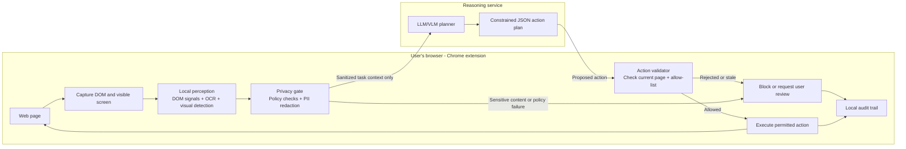
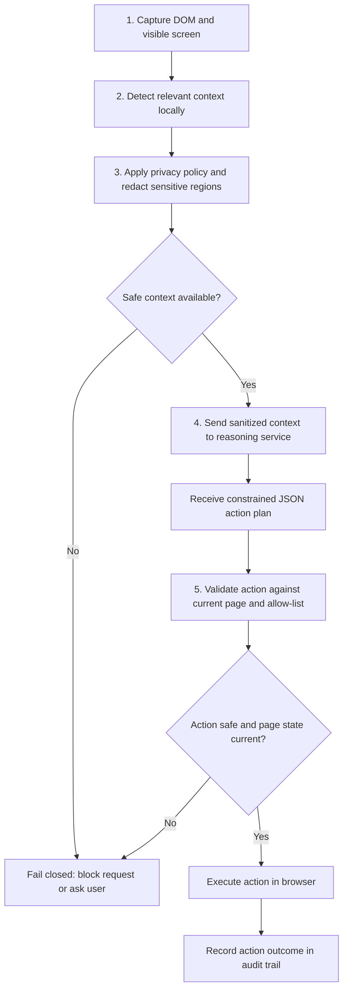

# PRIVAGENT

**Privacy-first visual perception for browser agents**

PRIVAGENT is a proposed browser-agent architecture for completing structured web tasks while minimizing the sensitive page data sent to remote AI services. It combines page structure and visual context on the user's device, applies a local privacy gate, and sends only sanitized task context to a server for planning. The browser client validates any returned action against the live page before execution.

> **Project status:** This README describes the proposed solution in the SIH 2026 project blueprint. Model selection, accuracy, resource use, latency, and browser support are benchmark decisions; the blueprint does not report measured prototype results.

## Project details

| Field | Value |
| --- | --- |
| Problem statement | SIH26171 - On-device Visual Perception for Light-weight Browser Agents |
| Theme | Smart Automation |
| Category | Software |
| Team | BLUE HORIZON |
| Team ID | T040_BLUE_HORIZON_Software |

## Why PRIVAGENT

Browser agents may need both DOM information and what is visibly rendered on a page. A page can contain private information, so sending a full DOM or screenshot to a remote model can expose more data than a task requires. PRIVAGENT places perception and redaction on the device, then uses a remote reasoning service only with the resulting safe context.

## Architecture

### Processing flow

## Key design principles

- **Local-first perception:** Inspect DOM structure and visible screen context on the device.
- **Privacy before network:** Apply detection, policy checks, and redaction before sending a request.
- **Sanitized server reasoning:** The remote planner receives safe task context rather than an unfiltered page capture.
- **Validate before acting:** Treat server output as a proposal. Check it against the live page and allowed actions.
- **Fail closed:** Block an action when sensitive content is detected, page state is stale, or validation fails. Protected fields must not receive automated typing.
- **Auditable actions:** Keep an audit trail for review.

## Proposed technology

| Layer | Proposed technology / role |
| --- | --- |
| Browser client | Chrome WebExtensions and JavaScript |
| Page context | DOM inspection and screenshot capture |
| Local vision and OCR | ONNX Runtime Web and Transformers.js; model choice to be benchmarked |
| Browser inference | WebGPU preferred, with WebAssembly fallback |
| Server reasoning | LLM/VLM returns constrained JSON actions |
| Client execution | Validate plans locally, then act on the page |

## Risks and mitigations

| Risk | Proposed mitigation |
| --- | --- |
| PII appears in a screenshot but not in DOM signals | Combine DOM signals, OCR, visual detection, and policy rules. |
| Inference speed or resource use varies by device and browser | Run a small model in a worker; provide a WASM fallback; benchmark across target environments. |
| A returned action is stale or unsafe for the current page | Fail closed and validate allow-listed actions against the live page immediately before execution. |
| Sensitive values could be entered into protected fields | Block automated typing into protected fields. |

## Evaluation plan

The SIH blueprint lists these judging weights. They are evaluation priorities, not reported PRIVAGENT results.

| Evaluation area | Weight |
| --- | ---: |
| Visual context accuracy | 25% |
| PII precision and recall | 20% |
| Redaction precision | 20% |
| Client resource use | 20% |
| End-to-end latency | 15% |

Model size, accuracy, browser support, and latency should be measured on the prototype before making performance claims.

## References

- [SIH 2026 Problem Statements Catalogue](https://www.sih.gov.in/) - SIH26171 and evaluation criteria, as cited in the project blueprint.
- [ONNX Runtime Web](https://onnxruntime.ai/docs/tutorials/web/) - Browser inference and WebGPU / WebAssembly execution providers.
- [Transformers.js WebGPU guide](https://huggingface.co/docs/transformers.js/guides/webgpu) - Browser model inference using WebGPU.
- [Chrome Extensions: Content scripts](https://developer.chrome.com/docs/extensions/develop/concepts/content-scripts) - DOM access and extension context.

## Team

**BLUE HORIZON**  
Team ID: `T040_BLUE_HORIZON_Software`  
Smart India Hackathon 2026 | Problem statement `SIH26171`

